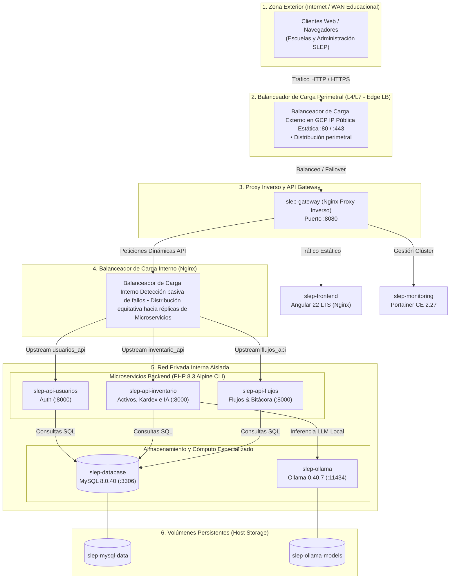

# Topología del Clúster de Microservicios, Balanceadores y Proxy Inverso

Este diagrama modela la arquitectura completa de distribución de tráfico, alta disponibilidad y contención de recursos del clúster containerizado para el **SLEP Los Libertadores**, integrando explícitamente los **dos balanceadores de carga** y el **proxy inverso**:

---

## Justificación para la Defensa de la Unidad 2: ¿Por qué 2 Balanceadores y 1 Proxy Inverso?

Esta separación se justifica en tres capas funcionales:

### 1. Balanceador de Carga Perimetral / Externo (Capa L4/L7)

- **Función:** Es el primer punto de contacto en la nube (GCP Cloud Load Balancing).
- **Justificación:** Recibe el volumen masivo de tráfico concurrente desde las escuelas y dependencias públicas del SLEP. Si el clúster crece horizontalmente a múltiples máquinas virtuales o nodos de cómputo, este balanceador externo distribuye el tráfico entre las distintas instancias de Nginx Gateway sin que los usuarios finales perciban interrupciones (alta disponibilidad perimetral).

### 2. Proxy Inverso (API Gateway en slep-gateway)

- **Función:** Centraliza la lógica de seguridad y el punto único de entrada.
- **Justificación:** Oculta la topología interna del sistema. Ningún cliente accede jamás de forma directa a los contenedores PHP, MySQL ni Ollama. Además, se encarga de:
  - Aplicar cabeceras de seguridad.
  - Comprimir en tiempo real el bundle de Angular.
  - Enrutar el tráfico por contexto URL (`/api/auth/`, `/api/activos/`, `/api/movimientos/`, `/portainer/`).

### 3. Balanceador de Carga Interno (Upstreams L7 en Nginx)

- **Función:** Balanceo a nivel de capa de aplicación mediante directivas upstream (`usuarios_api`, `inventario_api`, `flujos_api`).
- **Justificación:** Permite escalar los microservicios backend de forma independiente (por ejemplo, levantar réplicas de `backend-inventario` si hay alta demanda de Kardex) mediante _Keepalive sockets_. Posee tolerancia a fallos (`max_fails=3 fail_timeout=10s`), aislando automáticamente a cualquier contenedor backend que presente fallas sin voltear el clúster completo.

---

## Tabla de Asignación y Contención de Recursos (Compose Resource Limits)

| Servicio              | Rol Arquitectónico                                  | Usuario de Ejecución | Límite CPU | Límite RAM | Reserva RAM |
| :-------------------- | :-------------------------------------------------- | :------------------- | :--------: | :--------: | :---------: |
| `slep-gateway`        | Proxy Inverso y Balanceador Upstream L7             | Nginx                |    0.50    |   256 MB   |    64 MB    |
| `slep-frontend`       | Servidor Web Estático Angular 22                    | Nginx                |    0.50    |   256 MB   |    64 MB    |
| `slep-api-usuarios`   | Microservicio de Identidad y Roles (RF-01)          | www-data             |    0.75    |  1024 MB   |   256 MB    |
| `slep-api-inventario` | Microservicio de Inventario, Kardex e IA (RF-02/04) | www-data             |    1.25    |  1536 MB   |   512 MB    |
| `slep-api-flujos`     | Microservicio de Solicitudes y Auditoría (RF-03/05) | www-data             |    0.75    |  1024 MB   |   256 MB    |
| `slep-database`       | Persistencia Relacional MySQL 8.0                   | mysql                |    2.00    |  3072 MB   |   1024 MB   |
| `slep-ollama`         | Motor de Inferencia LLM Local (Qwen 2.5)            | ollama               |    2.00    |  2048 MB   |   512 MB    |
| `slep-monitoring`     | Dashboard Operacional Portainer CE                  | root                 |    0.50    |   256 MB   |    64 MB    |
