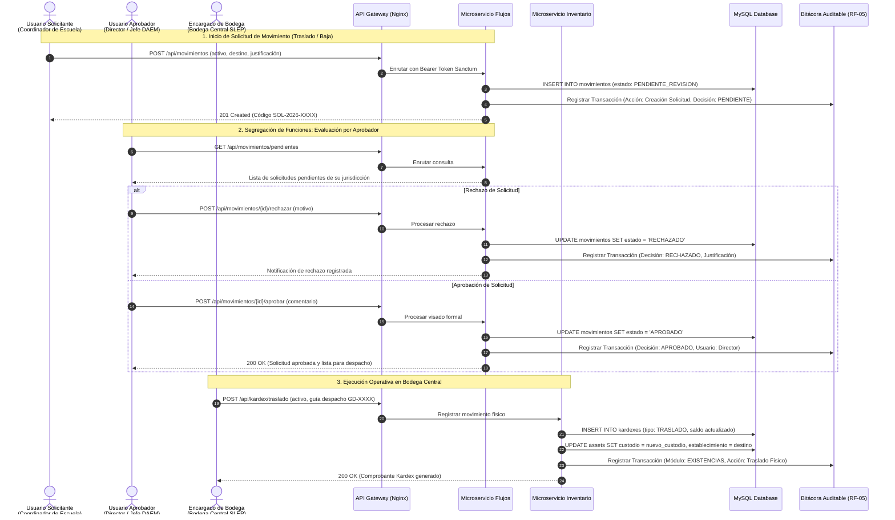

# Flujo de Solicitudes y Segregación de Funciones (RF-03 y RF-05)

Este diagrama modela la interacción entre los diferentes perfiles del SLEP Los Libertadores, garantizando la **segregación de funciones** (un solicitante no puede visar sus propias solicitudes) y el registro inmutable en la bitácora de auditoría.

### Reglas de Negocio Institucionales

1. **Incompatibilidad de Roles:** Un usuario con rol SOLICITANTE tiene bloqueados los endpoints `/api/movimientos/{id}/aprobar` y `/rechazar`.
2. **Inmutabilidad de la Bitácora:** Cada registro en bitacora_transacciones almacena el estado JSON (valores_anteriores y valores_posteriores), impidiendo modificaciones de auditoría.
