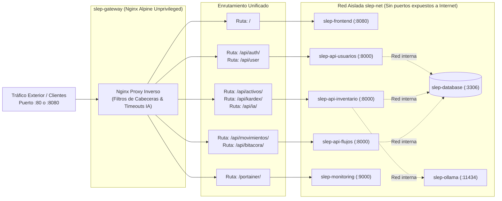

# Seguridad Perimetral y Ruteo de Gateway Nginx

Este diagrama describe cómo el contenedor `slep-gateway` opera como único punto de entrada perimetral hacia el clúster, aislando los microservicios y la base de datos de Internet:

### Medidas de Blindaje Aplicadas

1. **Sin Exposición de Puertos Backend a Internet:** Los contenedores backend-usuarios, backend-inventario, backend-flujos y ollama únicamente utilizan la directiva **expose** en Docker Compose, impidiendo accesos no autorizados desde fuera de la red **slep-net**.
2. **Ejecución como Usuario No Privilegiado:** Nginx corre bajo nginx y PHP bajo www-data.
3. **Caché y Compresión Gzip:** Todo el contenido estático de Angular es comprimido al vuelo en el Gateway para minimizar el ancho de banda y la latencia.
